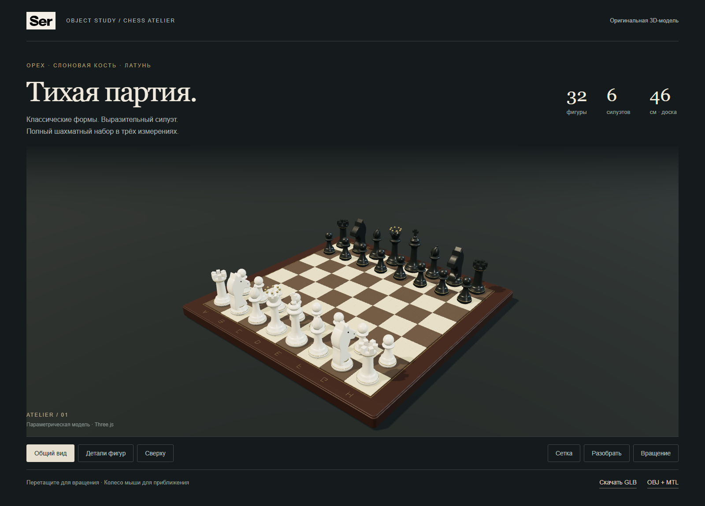

# Серафим Мельник · цифровое портфолио

## Менеджмент компьютерного клуба

[**Ser Club — Telegram, контент и турниры**](club-manager/): план на 30 дней, рекламная модель с лимитом 10 000 ₽, учёт участников и витрина услуг. [Автономная панель](club-manager/Ser-Club.html), [проверки](club-manager/QA.md) и пять настоящих скриншотов. Все данные учебные; коммерческий рост не заявляется.

Демонстрационные проекты: видео, графика, обработка речи, отчёты, сайты и автоматизация. В аудиодемо звучит живая запись русского диктора. Заказы в отчётах и товары на витринах — учебные примеры.

## Приложения на разных языках, игра и 3D

[Восемь новых демонстрационных проектов](polyglot-lab/):

- [CRM на TypeScript и SQLite](polyglot-lab/CRM.md)
- [Оптовые заказы на PHP](polyglot-lab/WHOLESALE.md)
- [Согласование расходов на C#](polyglot-lab/APPROVAL.md)
- [Проверка прайса перед импортом](polyglot-lab/PRICE-CHECK.md)
- [RSS/Atom-парсер на Go](polyglot-lab/FEED.md)
- [Автоматическая сверка счетов и оплат](polyglot-lab/RECONCILE.md)
- [Браузерная головоломка Cargo](polyglot-lab/GAME.md)
- [3D-шахматы: доска и 32 фигуры, GLB/OBJ](polyglot-lab/CHESS.md)

50 функциональных проверок, реальные скриншоты запущенных приложений и адаптивных интерфейсов. Полное дерево исходников и инструкции — в [архиве](polyglot-lab/ser-polyglot-source.zip). Данные учебные; запуск BSL-модуля внутри 1С пока не проверен.

## Автоматизация для бизнеса

[Три новых кейса с кодом и проверками](business-automation/): [очистка базы клиентов](business-automation/CRM.md), [проверка каталога CommerceML для обмена с 1С](business-automation/CATALOG.md), [сроки и загрузка команды](business-automation/TEAM.md). 19 тестов; все данные учебные.

[Прежние работы: задачи, решения и подтверждённые результаты](business-automation/PREVIOUS-CASES.md). Выручка учебного магазина не выдаётся за рост продаж клиента.

## Новое · ноябрь 2026

[**Три работы по мотивам актуальных запросов на фрилансе**](demand-lab/): [вертикальный ролик](demand-lab/motion/), [комплект графики](demand-lab/social-kit/) и [автоматизация заказов](demand-lab/order-bridge/). Внутри — готовые файлы, исходники, результаты проверок и честные ограничения демонстраций.

## Другие работы

| Проект | Что посмотреть | Что проверить |
|---|---|---|
| [Обработка речи](audio/) | [Звук до обработки](audio/before.wav) и [после обработки](audio/after.wav) | Послушайте паузу перед голосом на одинаковой громкости, затем сравните разборчивость речи. В папке есть схема обработки и способ повторить измерение. |
| [Отчёт по продажам](sales-report/) | [Книга Excel](sales-report/sales-report.xlsx), [исходные заказы](sales-report/orders.csv), [изображение дашборда](sales-report/dashboard.png) | Сопоставьте выручку и число оплаченных заказов с исходными строками. Измените данные или фильтр и посмотрите, как пересчитывается отчёт. |
| [Витрина акустики](storefront/) | [Стартовая страница](storefront/index.html) | Скачайте папку целиком, откройте `index.html` в браузере и подберите модель по параметрам. Для работы витрины интернет не требуется. |
| [Telegram-бот для заявок](telegram-bot/) | [Исходный код на Python](telegram-bot/bot.py) | Пройдите демонстрационный диалог, подтвердите заявку и проверьте, что при повторном подтверждении сохраняется одна запись. Локальная проверка работает без токена. |
| [Отбор заказов в n8n](n8n/) | [Сценарий для импорта](n8n/fl-orders-n8n.json) | Посмотрите, какие записи проходят отбор по теме и как убираются повторы. В папке есть инструкция по импорту и проверке. |

Для локального просмотра распакуйте весь архив, сохранив структуру папок. В каждой папке есть отдельный `README.md` с инструкцией и условиями проверки.

