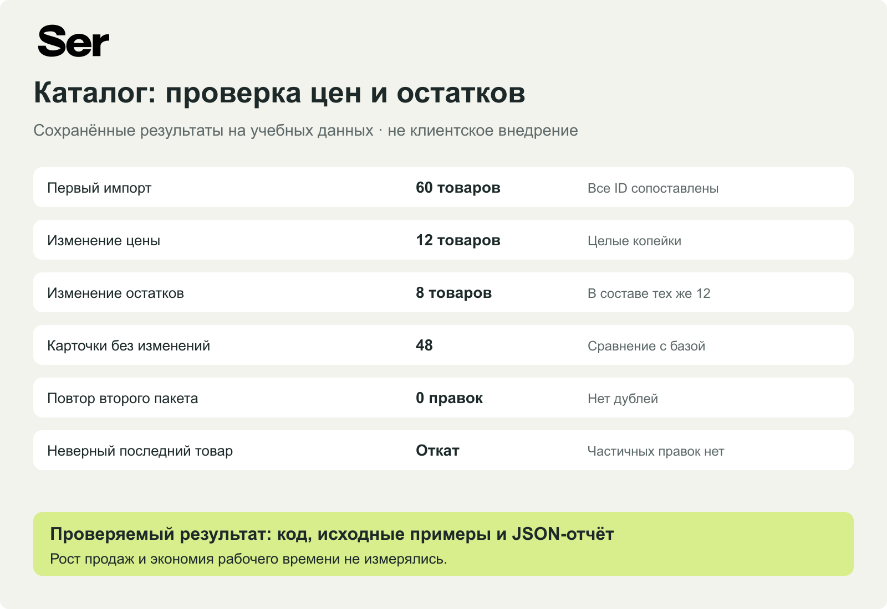

# Ser Catalog Check · проверка выгрузки для обмена с 1С

**Сценарий.** Магазин канцелярии готовит выгрузку товаров для сайта. Нужно проверить цены и остатки до изменения витрины. Магазин и его ассортимент вымышленные.

**Задача.** Сопоставить каталог и предложения по ID, показать изменения и не применить пакет частично при ошибке.

**Решение.** Локальный Python-обработчик читает UTF-8 XML: каталог и предложения с меткой CommerceML 2.10. Проверяет ID каталога, даты пакетов с часовым поясом, дубли SKU, валюту, цену и целый остаток. Деньги хранятся в копейках. Изменения записываются в SQLite одной транзакцией. Повтор того же пакета ничего не меняет, устаревший пакет отклоняется.

**До → после на учебных данных.** Первый пакет создаёт 60 товаров. Второй меняет цены 12 товаров и остатки 8 из них: обновлено 12 карточек, 48 не изменились. Для OFF-000 цена 90 → 100 ₽, остаток 20 → 17 шт. Повтор: 0 новых изменений, по-прежнему 60 товаров. Тест ошибки в последнем товаре подтверждает отсутствие частичных изменений.

**Польза.** Перед переносом данных виден объём изменений, а неверная выгрузка не портит часть каталога. Это измеренный результат локального теста, не завершённое внедрение и не рост продаж.

## Совместимость и ограничения

CommerceML используется для обмена коммерческими данными; ориентиры — [официальная схема 1С](https://v8.1c.ru/tekhnologii/obmen-dannymi-i-integratsiya/standarty-i-formaty/standarty-commerceml/commerceml-2/) и [описание обмена с интернет-магазином](https://v8.1c.ru/tekhnologii/obmen-dannymi-i-integratsiya/realizovannye-resheniya/obmen-dannymi-s-internet-magazinom/), проверенные 25.11.2026.

Реализован **ограниченный поднабор полей**, а не полная XSD-валидация CommerceML или HTTP-протокол обмена. Один каталог, одна рублёвая цена, коэффициент 1, единица 796 (штуки), целый остаток; нет характеристик, нескольких складов, скидок, налогов и удаления отсутствующих товаров. Неизвестные дополнительные поля игнорируются. Ограничение XML — 2 МБ, DTD и сущности запрещены. UTF-16 не поддерживается. База 1С, конфигуратор и Битрикс не подключались. Совместимость с конкретной конфигурацией требует её тестовой выгрузки.

Код: [catalog_exchange.py](catalog_exchange.py). Генератор примеров: [run_demo.py](run_demo.py).
