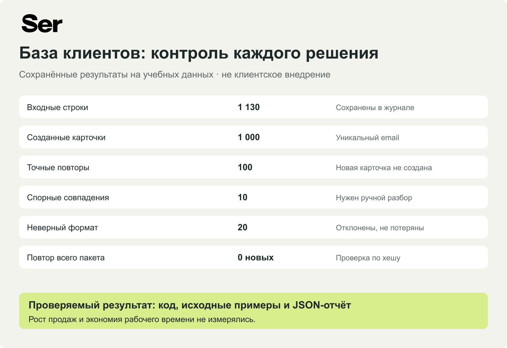

# Ser Clean CRM · очистка базы клиентов

**Сценарий.** Небольшая студия объединяет выгрузки заявок. Регистр и пробелы различаются, часть клиентов записана повторно, встречаются общие почтовые адреса. Это модель задачи, не реальный заказ.

**Задача.** Получить единый справочник, сохранить происхождение записей и не объединить разных людей автоматически.

**Решение.** Python нормализует пробелы и регистр email, проверяет формат полей и сохраняет карточки в SQLite. Совпадение email и нормализованного имени считается повтором. Одинаковый email при разных именах уходит на ручной разбор. Все исходные строки сохраняются в журнале вместе с решением обработчика. Повтор пакета определяется по хешу содержимого; запись пакета и карточек проходит одной транзакцией.

**До → после на учебных данных.** 1 130 строк → 1 000 уникальных карточек; 100 повторов не создают новые карточки; 10 спорных строк оставлены для решения человеком, 20 неверных адресов отклонены. Повтор всего файла: 0 новых записей. Распределение сверяется: 1 000 + 100 + 10 + 20 = 1 130.

**Польза.** Меньше повторных карточек и понятный список исключений. Экономия рабочего времени и рост продаж на реальном предприятии не измерялись.

**Границы.** Совпадение по опечаткам, объединение телефонов, семейных адресов и изменение уже импортированной карточки не реализованы. Email целиком приводится к нижнему регистру — это явно выбранное правило демо, которое нужно согласовать для реальной базы. Образцы используют зарезервированный домен `example.invalid`.

Код: [crm_clean.py](crm_clean.py). Проверка: [test_automation.py](test_automation.py). Все 19 тестов комплекта прошли.
