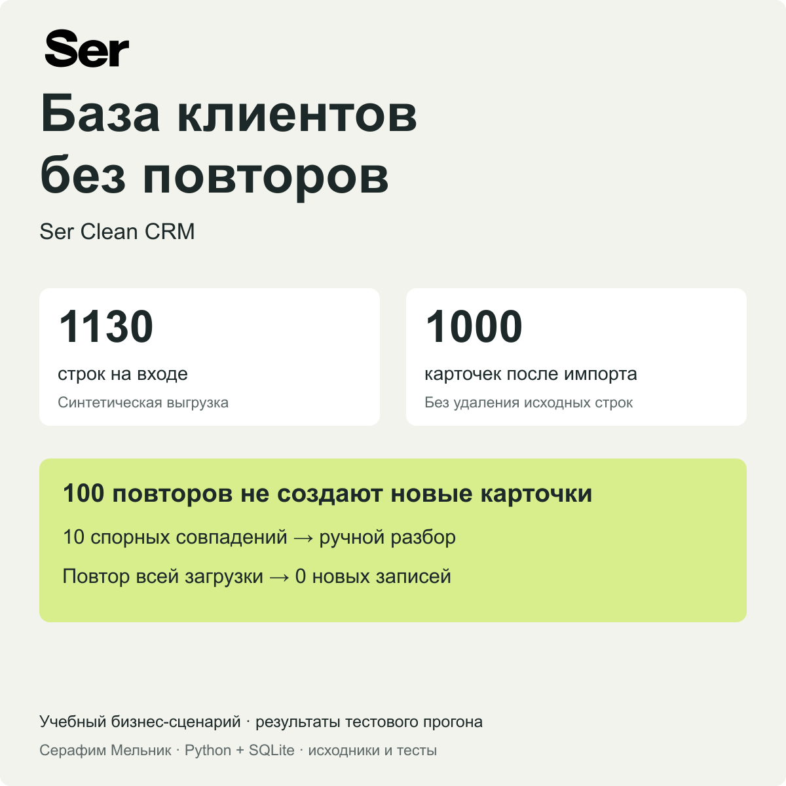

# Ser · автоматизация ежедневных операций

Три работающих демонстрационных кейса Серафима Мельника: база клиентов, каталог CommerceML для обмена с 1С и контроль сроков команды. **Бизнес-сценарии и данные вымышленные; результаты ниже измерены на этих данных. Коммерческие внедрения, отзывы и рост продаж не заявляются.**

| Задача | Результат тестового прогона | Кейс |
|---|---|---|
| Навести порядок в базе клиентов | 1 130 строк → 1 000 карточек, 100 повторов, 10 спорных и 20 ошибочных строк | [Ser Clean CRM](CRM.md) |
| Проверить перенос цен и остатков | 60 товаров; следующий пакет обновил 12 карточек, повтор не изменил базу | [Ser Catalog Check](CATALOG.md) |
| Собирать сводку руководителю | 48 задач → 12 просрочек, 8 сроков сегодня, 4 блокировки | [Ser Team Pulse](TEAM.md) |



## Запуск

Python 3.11+ со стандартной библиотекой. Устанавливать пакеты не нужно. Команды выполняются из этой папки:

```sh
python -m unittest -v
python run_demo.py --output result
```

Сценарий создаёт учебные JSON/XML в `result/inputs`, запускает три обработчика в отдельных временных SQLite-базах, закрывает соединения и сохраняет `result/report.json`. Повторный демопрогон намеренно использует чистые базы. Проверка повторного импорта внутри одного прогона работает с одной и той же базой. [Сохранённый результат](report.json), [входные примеры ZIP](fixtures.zip).

Для обработки своей **локальной копии** выгрузки:

```sh
python cli.py crm result/inputs/clients.json --db crm.sqlite --report crm-first.json
python cli.py catalog result/inputs/catalog-initial.xml --offers result/inputs/offers-initial.xml --db catalog.sqlite --report catalog-first.json
python cli.py team result/inputs/tasks.json --as-of 2026-11-25T12:00:00+09:00 --db team.sqlite --report team-first.json
```

Новые имена отчётов сохраняют историю проверок. SQLite-базы и реальные данные не публикуйте. 19 тестов покрывают повторы, конкурентный импорт, спорные идентификаторы, откат пакета, XML с DTD, старые выгрузки, часовые пояса и закрытые задачи. Число тестов относится ко всему комплекту.

## Что можно адаптировать под заказ

Согласовать поля исходной выгрузки и критерии приёмки; выполнить пробный импорт копии; сверить суммы и количество записей; затем отдельно подключить рабочие системы, права доступа, резервное копирование и расписание. В демо нет подключения к CRM, Telegram, n8n или базе 1С. Не проводились нагрузочные испытания и аудит для промышленной эксплуатации.

Графика показывает сохранённые результаты, а не скриншоты рабочего кабинета клиента. Пересборка изображений: `npm install --no-save sharp`, затем `node render-covers.cjs`. Основным Python-программам Node.js не нужен.
