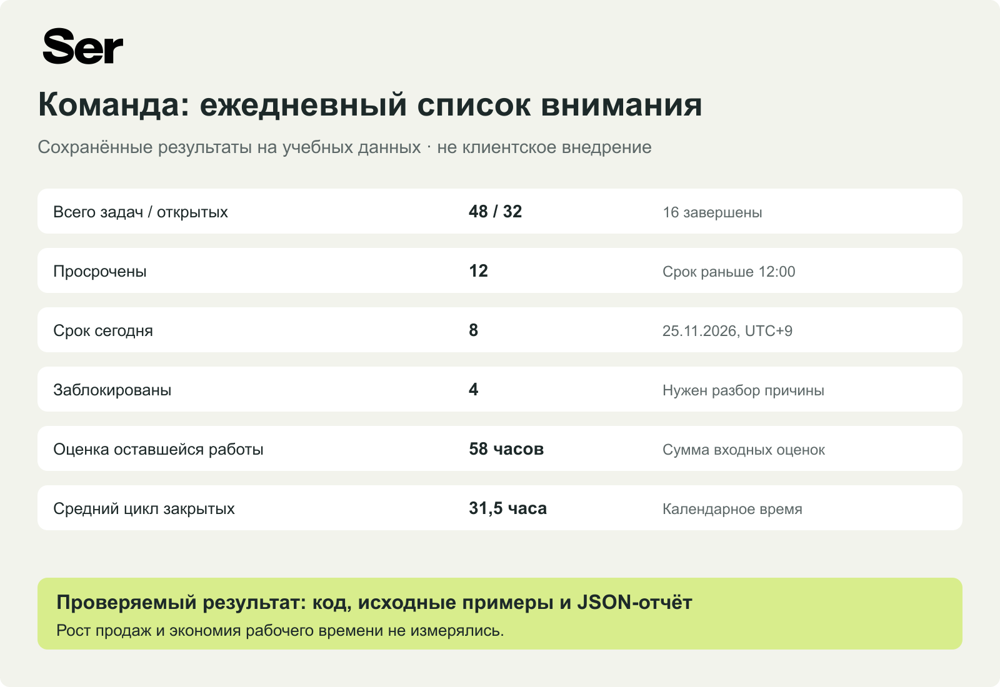

# Ser Team Pulse · сроки и загрузка команды

**Сценарий.** Руководитель небольшой команды каждый день просматривает список задач, чтобы найти просрочки, блокировки и сроки на сегодня. Команда из четырёх специалистов вымышленная.

**Задача.** Получать проверяемую сводку из локальной выгрузки и не создавать повторное напоминание для той же задачи в тот же день.

**Решение.** Python проверяет статусы, уникальность ID и даты с часовым поясом; строит список внимания и сумму оставшейся работы по каждому специалисту. SQLite хранит локальную очередь напоминаний с уникальной парой «день + задача». Закрытые задачи не становятся просроченными. Часовой пояс отчёта задаётся параметром `--as-of`.

**Результат учебного прогона на 25.11.2026, 12:00 UTC+9.** Из 48 задач закрыто 16, открыто 32. Найдены 12 просроченных, 8 со сроком сегодня и 4 заблокированных задачи. Созданы 24 записи локальной очереди, повторный запуск добавил 0. Оценка оставшейся работы — 58 часов на команду; это сумма входных оценок, не затраченное время. Средний цикл 16 закрытых задач — 31,5 календарного часа (создание → завершение), не средняя производительность сотрудника.

**Польза.** Руководитель получает конкретный список задач для разбора и видит распределение оценок нагрузки. Сокращение просрочек после внедрения и экономия времени не измерялись.

**Границы.** Демо не отправляет сообщения и не подключается к рабочим таск-трекерам. Один запуск = снимок данных; последующие изменения задачи в тот же день не создают новое напоминание и не заменяют сохранённое. Дневная дедупликация предполагает один согласованный часовой пояс. Календарь праздников, права пользователей и доставка уведомлений требуют отдельного подключения. Просрочка/срок сегодня взаимно исключаются; блокировка может пересекаться с ними на других входных данных.

Код: [team_digest.py](team_digest.py). [Полный отчёт](report.json) содержит список задач и владельцев.
