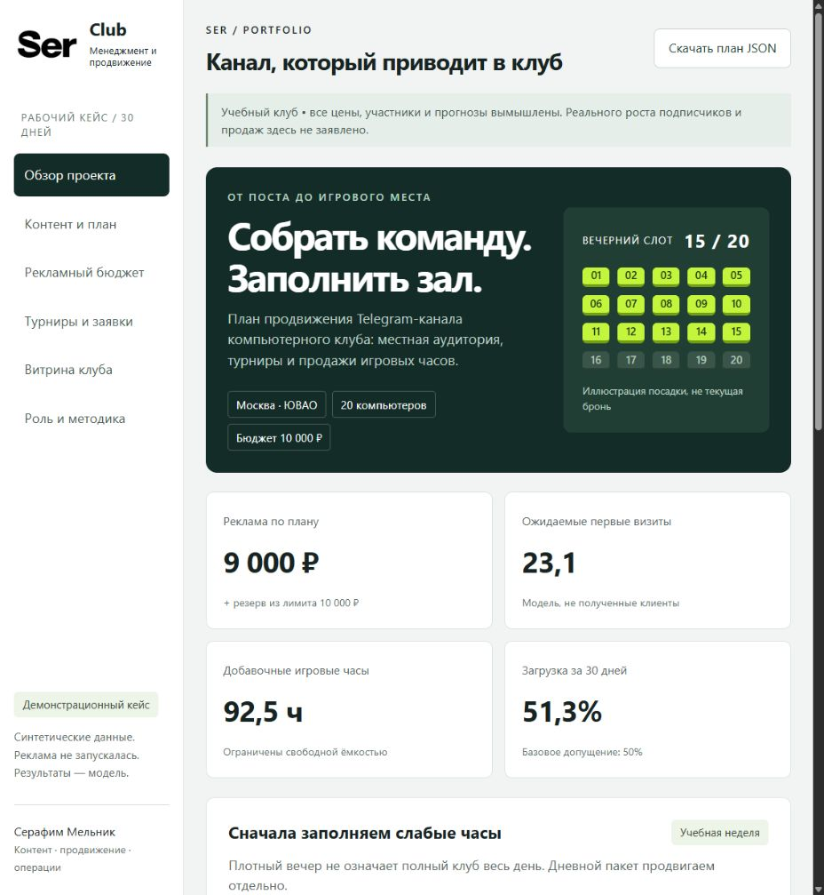

# Ser Club — менеджмент и продвижение компьютерного клуба

**Демонстрационный кейс Серафима Мельника.** Вымышленный клуб, синтетические данные, учебные тарифы и рекламные гипотезы. Реальная реклама не запускалась; роста продаж и подписчиков этот проект не доказывает. 

## Задача

Построить понятную работу с Telegram-каналом компьютерного клуба: привлечь местную аудиторию, получить заявки на турниры и заполнить слабые часы. География модели — Москва, ЮВАО. План — 30 дней, рекламный лимит — 10 000 ₽. Управление магазином показано через витрину услуг: карточки игровых пакетов, турнир и заявка на бронь.

## Что можно открыть

- `index.html` через локальный сервер — рабочая панель из шести разделов.
- `plan.json` — полный план, сценарий и данные модели без персональных данных.
- `CONTENT-PLAN.md` — задачи и тексты на все 30 дней.
- `MANAGEMENT.md` — правила принятия решений, отчётности и работы с заявками.
- `Ser-Club.html` — автономная версия: откройте двойным щелчком, сервер и установка не нужны.

Запуск: `node server.mjs`, затем http://127.0.0.1:8805 . Node.js 18+; установка пакетов не требуется. Проверки: `node --test model.test.mjs`. Страница использует ES-модули, поэтому простое открытие через `file://` может не работать. Завершение локального сервера: Ctrl+C.

## Что действительно работает

Навигация, 30 карточек плана, фильтрация задач, просмотр текстов, изменение рекламных допущений и условий клуба, три сценария конверсии, пересчёт экономики, учебные заявки и подтверждение с лимитом 20 мест, карточки услуг и скачивание текущего состояния в JSON. Изменения живут в памяти вкладки; после обновления восстанавливаются исходные данные. Бронирования и публикации в Telegram не отправляются.

## Базовый расчёт — не достигнутый результат

План расходов: 4500 ₽ на районные каналы, 3000 ₽ на игровые сообщества, 1500 ₽ на повторное размещение после проверки результатов. Нераспределённый резерв 1000 ₽. Ставки перехода 25/30/20 ₽, конверсия в бронь 8/10/6%, явка 80% — только допущения.

Модель даёт 355 переходов,28,9 броней и 23,12 ожидаемого первого визита. Дробные числа — математическое ожидание, не список людей. При 4 часах на визит это 92,48 PC-часа. При 20 компьютерах ×12 часов ×30 дней ёмкость 7200 часов: загрузка меняется с 50% до 51,28%. Одной этой кампании недостаточно, чтобы заполнить весь клуб.

Средняя фактическая цена часа в модели 200 ₽, добавочные затраты 35 ₽. Вклад после рекламы:92,48×165−9000=6259,20 ₽ **до постоянных затрат и при нулевой оценке труда**. Это не чистая прибыль. Если оценить работу менеджера в 5000 ₽, вклад снизится до 1259,20 ₽. Первый визит стоит около 389,27 ₽; порог покрытия рекламы —14 пришедших гостей. При снижении конверсии вдвое вклад станет−1370,40 ₽ до постоянных затрат и труда. Сверх доступной ёмкости дополнительные продажи не начисляются.

Экран недельной тепловой карты — отдельный пример распределения часов; он не вычисляет месячную базу. Регистрации турнира и витрина также демонстрационные; они не добавляются в рекламную выручку. Это исключает двойной подсчёт одного визита.

## Роль автора

По словам Серафима: вёл сообщества, писал посты, покупал рекламу, общался с покупателями, заполнял карточки, организовывал людей. Не заявляются неподтверждённые работодатели, сроки опыта, масштабы кампаний или коммерческие результаты.

Для реального запуска нужны исходная статистика, действующие тарифы, адрес и расписание клуба, права на материалы, согласованные размещения и регламент турнира. Поддержка эквайринга, CRM, настоящей загрузки ПК и Telegram API в демо не реализована.

## Проверка

Девять автоматических проверок расчётов и лимита участников пройдены. Синтаксис автономной сборки проверен. Выполнена ручная проверка работающего интерфейса в браузере. Сценарии и границы проверки — в [QA.md](QA.md).

## Настоящие скриншоты

[Бюджет](screenshots/02-campaigns.jpg) · [Контент-план](screenshots/03-calendar.jpg) · [Лимит турнира и очередь](screenshots/04-tournament-full.jpg) · [Витрина](screenshots/05-store.jpg)
