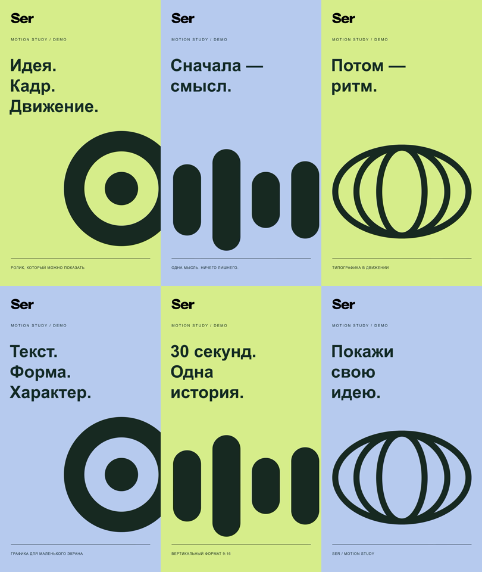
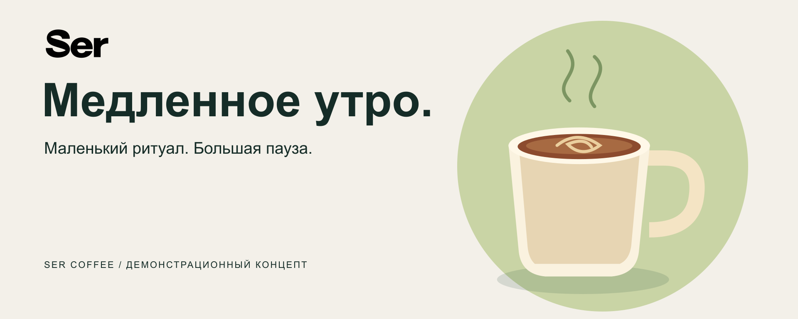

# Ser · три новых примера для портфолио

Видео, графика и автоматизация — самостоятельные демонстрационные работы Серафима Мельника. Ни один пример не выдаётся за коммерческий заказ, отзыв клиента или измеренный рост продаж.

## Что готово

| Проект | Готовый результат | Исходники и проверка |
|---|---|---|
| **Ser Motion** | [Ролик MP4, 30 секунд](motion/ser-motion.mp4), 1080 × 1920, 30 fps, собственный звук | [Сценарий и сборка](motion/README.md), шесть редактируемых SVG-сцен, генератор и FFmpeg-скрипт |
| **Ser Coffee** | [Пост](social-kit/post.png), [история](social-kit/story.png), [обложка](social-kit/cover.png), [набор иконок](social-kit/icons.png) | [Описание комплекта](social-kit/README.md), SVG-исходники всех макетов и девять отдельных иконок |
| **Ser Order Bridge** | Три заказа из восьми событий; [JSON-отчёт](order-bridge/example-result/report.json), [CSV](order-bridge/example-result/orders.csv) | [Python/SQLite-прототип](order-bridge/README.md), 12 автоматических тестов, очередь повторной доставки |

## Посмотреть вместе

Скачайте эту папку целиком и откройте [index.html](index.html) локально. Установка для просмотра не нужна. Страница содержит видеоплеер, переключение форматов и воспроизведение **сохранённого** прогона автоматизации. Реальный обработчик запускается отдельно из Python.

Для локального HTTP-предпросмотра: `node preview.mjs`, затем `http://127.0.0.1:8787`. Node.js нужен только для сервера и пересборки графики. Сервер слушает только loopback, не предназначен для публичного хостинга.

## Почему выбраны эти направления

25 ноября 2026 просмотрены 110 карточек в обычном интерфейсе FL.ru и YouDo: две страницы FL.ru после сброса фильтров и 50 карточек удалённой ленты YouDo.

| Группа задач цифрового производства | Число наблюдений |
|---|---:|
| Видео и анимация | 10 |
| Графический дизайн | 7 |
| Автоматизация, интеграции и боты | 7 |
| Сайты и доработки | 6 |

Это ограниченная выборка, **не рейтинг рынка в целом**. Группы широкие; отдельный демонстрационный проект не подтверждает владение всеми технологиями группы. Вакансии, опросы, звонки и прочие поручения вне цифрового производства не входят в рейтинг. Повтор простого Reels на двух площадках учтён один раз. Личные задания и заказы с выбранным исполнителем могут показывать спрос, но не являются предложениями для отклика.

Подробная методика, оговорки и номера заданий: [research.json](research.json). Примеры исходных запросов: [motion-баннер FL.ru](https://www.fl.ru/projects/5530340/cozdat-video-banner-dlya-magazina-zvezd-i-premiuma-v-telegram.html), [иконки для карточек YouDo](https://youdo.com/t15456211), [связь магазина с 1С FL.ru](https://www.fl.ru/projects/5530347/nujno-svyazat-internet-magazin-na-bitrikse-s-1s-ut-115.html).

## Проверки и ограничения

- Все 12 тестов Python прошли, включая конкурирующие запросы, перезапуск, потерянное подтверждение доставки и нехватку остатков.
- Готовый MP4 полностью декодирован: 900 кадров, 1080 × 1920, 30 fps, AAC 48 кГц. Контейнер около 30,02 секунды из-за аудиопакетов.
- Изображения просмотрены; исходники SVG и локальные ссылки проверены. Синтаксис JavaScript проверен Node.js.
- Облачный браузер не смог открыть локальный адрес; интерактивная браузерная проверка страницы не подтверждена.
- Настоящие 1С, Bitrix, Telegram и платёжные API не подключались. Это не готовое внедрение в рабочий магазин.

## Короткие описания для портфолио

**Видео:** «Вертикальная рекламная заставка: шесть типографических сцен, плавные переходы, собственный звуковой ритм. Экспорт 1080 × 1920, 30 fps. Самостоятельный демонстрационный проект».

**Дизайн:** «Единая графика вымышленной кофейной коллекции: пост, история, обложка и девять SVG-иконок. Векторная иллюстрация и редактируемые исходники. Демонстрационный концепт».

**Автоматизация:** «Прототип переноса заказов на Python/SQLite: валидация, резервирование остатков, защита от дублей и повтор после сбоя. Восемь тестовых событий дают три заказа. 12 тестов; внешняя учётная система имитируется».
