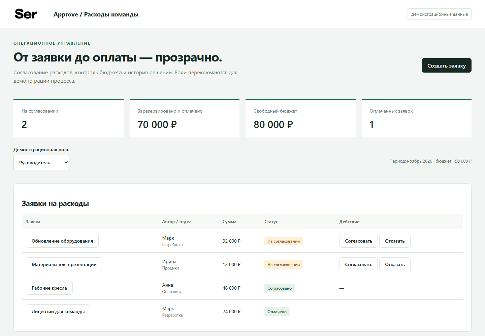
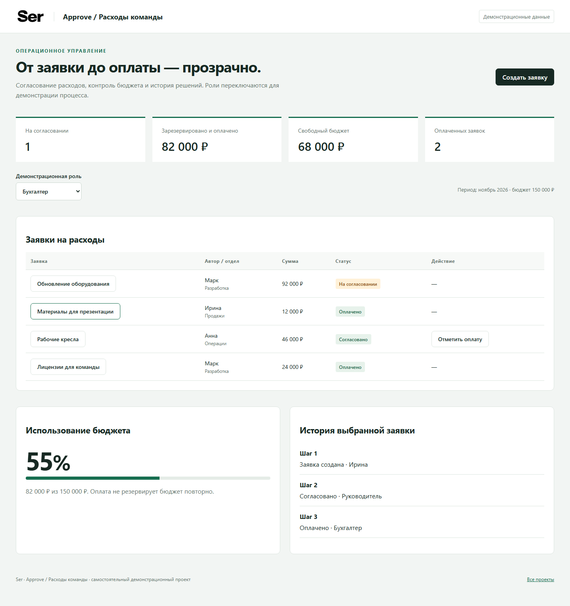

# Ser Approve — согласование расходов на C#

Самостоятельное веб-приложение на C# / ASP.NET Core. Задача: сделать расходы команды прозрачными. Реализованы создание заявки, роли сотрудника, руководителя и бухгалтера, согласование и отказ с причиной, отметка оплаты, лимит бюджета 150 000 ₽ и история решений. Повторное или устаревшее действие отклоняется. Оплата не резервирует бюджет второй раз. Данные сохраняются атомарно в JSON. Скриншоты показывают реальную работу приложения на вымышленных данных. Переключатель ролей демонстрационный, не заменяет авторизацию. Банковские операции не выполняются.

**Стек:** C# · ASP.NET Core · .NET 10

[Полный комплект исходников, инструкций и проверок](ser-polyglot-source.zip). Распакуйте и откройте `polyglot-lab/README.md`.
