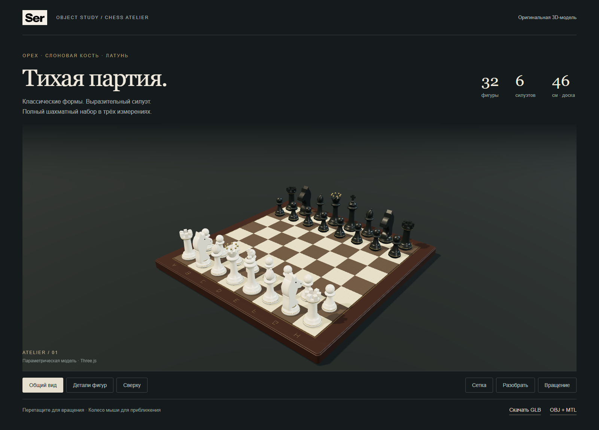
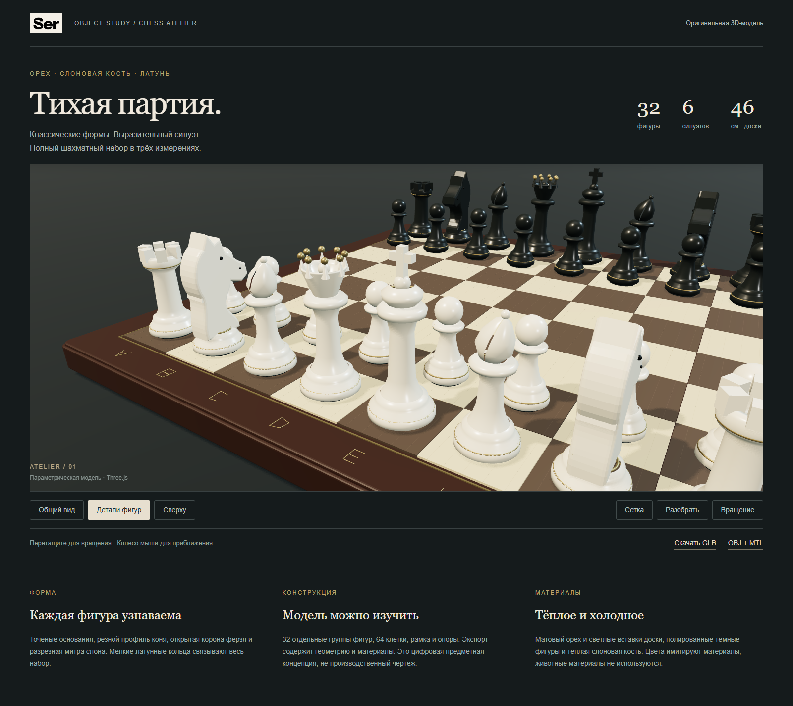
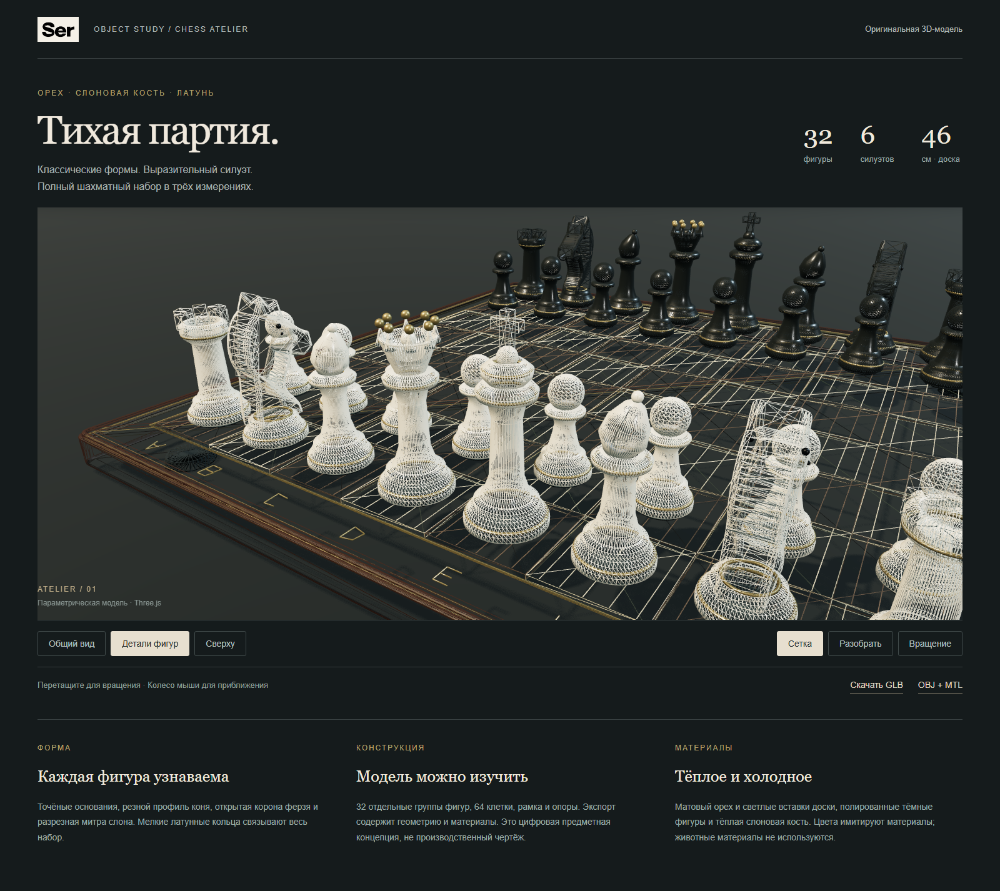

# Ser Chess — 3D-доска и полный набор фигур

Самостоятельная цифровая 3D-концепция шахмат: доска с рамкой под орех, латунные детали, 32 фигуры, 64 клетки, фетровые основания. Оригинальная параметрическая геометрия: профиль коня с гривой, короны, митры слонов, зубцы ладей. Интерактивный просмотр с вращением и приближением, несколькими камерами, сеткой и разборкой сцены. Экспорт GLB и OBJ/MTL. 761 mesh, 180 340 треугольников; доска с фаской 46,25 см. Состав и повторный импорт GLB проверены. Изображения — реальные кадры 3D-сцены. Это цифровая концепция, не изготовленное изделие, не производственный чертёж и не шахматный движок.

**Стек:** Three.js · GLB · OBJ/MTL · 3D

[Полный комплект исходников, инструкций и проверок](ser-polyglot-source.zip). Распакуйте и откройте `polyglot-lab/README.md`.

[Модель GLB](ser-chess.glb) · [OBJ и MTL](ser-chess-obj.zip) · [Исходник геометрии](chess-model.mjs).
