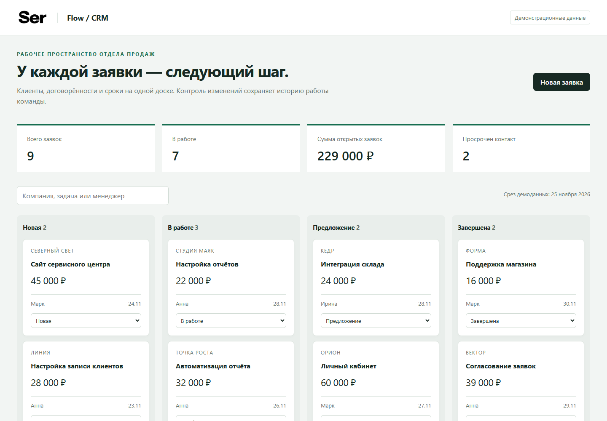
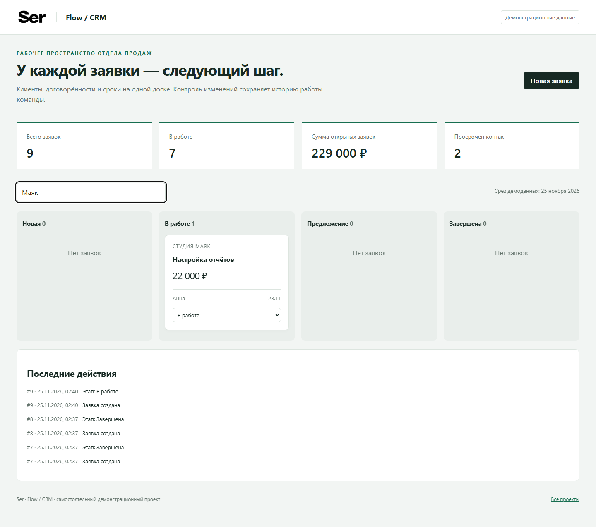

# Ser Flow — CRM на TypeScript

Самостоятельный демонстрационный проект на TypeScript / Node.js / SQLite. Задача: собрать заявки сервисной компании в одном месте. Реализованы создание и поиск заявок, ответственные, сроки, этапы сделки, суммы и журнал действий. Проверка версии карточки предотвращает потерю изменений при одновременной работе. На скриншотах — реально запущенное приложение и создание новой заявки. Данные вымышленные. Локальное демо без авторизации; подключение к реальному отделу продаж не выполнялось.

**Стек:** TypeScript · Node.js · SQLite

[Полный комплект исходников, инструкций и проверок](ser-polyglot-source.zip). Распакуйте и откройте `polyglot-lab/README.md`.
