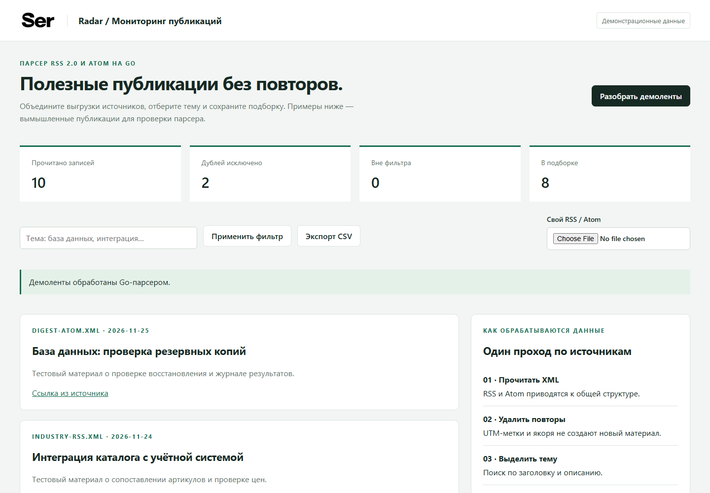
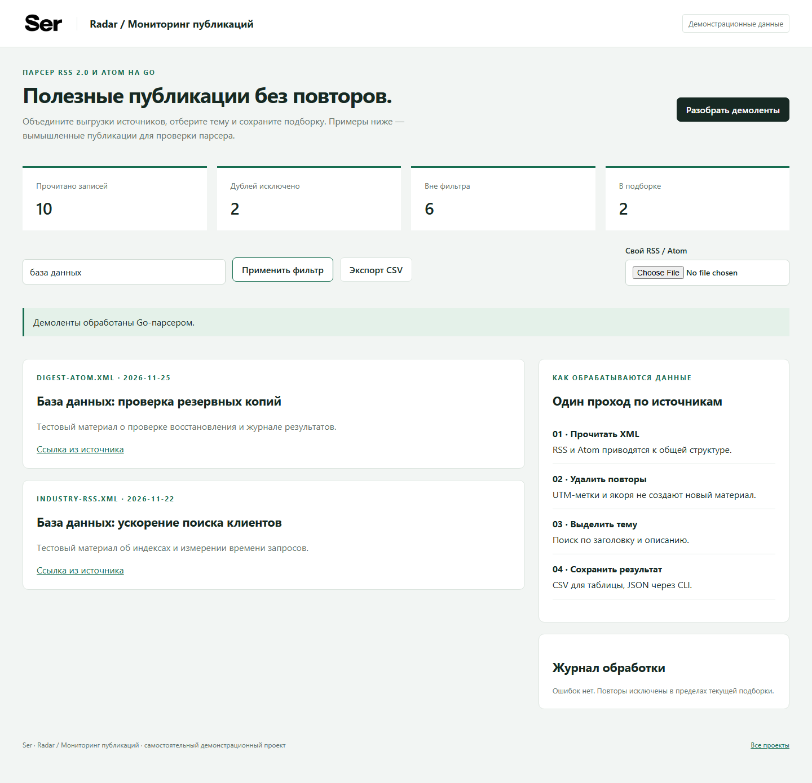

# Ser Radar — RSS и Atom парсер на Go

Самостоятельный парсер на Go для локальных XML-выгрузок RSS 2.0 и Atom. Приводит записи к единой структуре, нормализует ссылки, убирает UTM-метки и повторы, фильтрует заголовок и описание, сортирует даты. Есть браузерный интерфейс, загрузка своего XML, CLI и экспорт JSON/CSV. Ошибка одного источника не уничтожает остальные результаты. На демонаборе: 10 записей, 2 дубля, 8 уникальных материалов. Скриншоты показывают реальную обработку. Публикации вымышленные; внешние сайты автоматически не обходятся, дедупликация действует в пределах одной подборки.

**Стек:** Go · encoding/xml · HTTP · CSV

[Полный комплект исходников, инструкций и проверок](ser-polyglot-source.zip). Распакуйте и откройте `polyglot-lab/README.md`.
