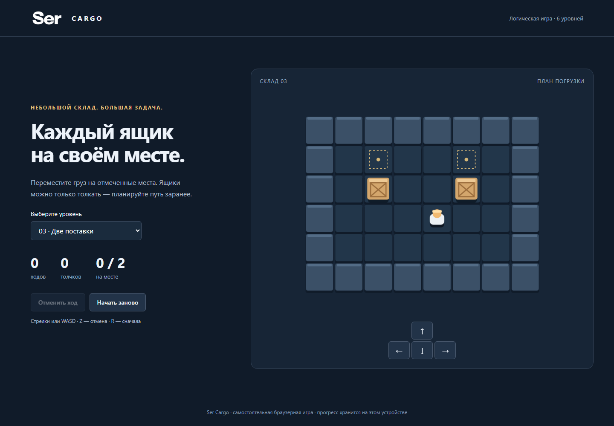
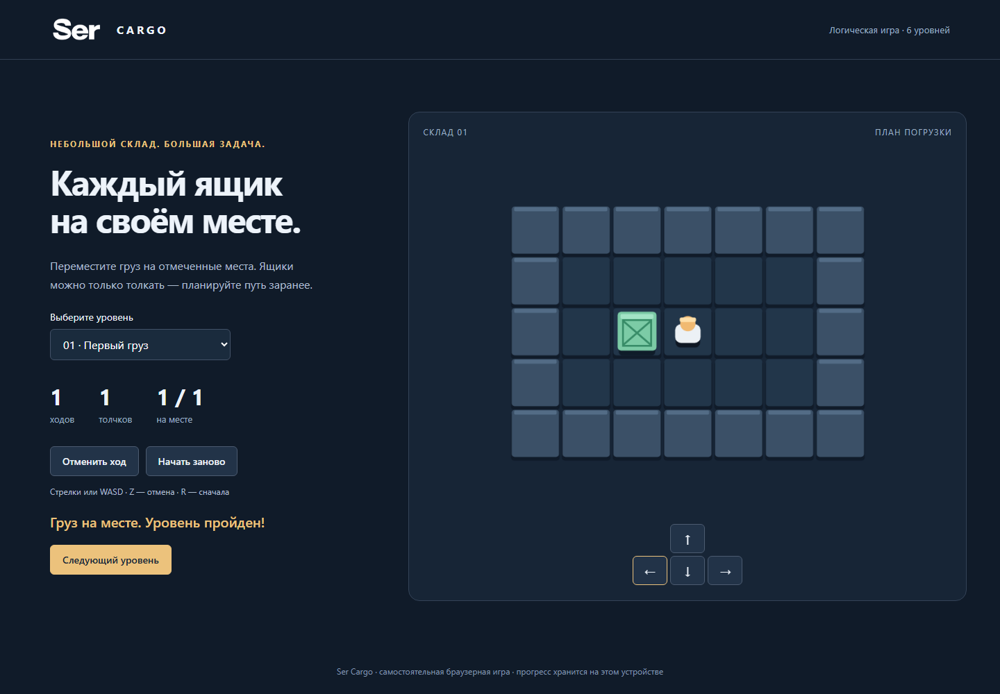

# Ser Cargo — браузерная головоломка

Самостоятельная браузерная игра: переместить ящики на отмеченные места, планируя путь. Шесть оригинальных небольших уровней, управление стрелками/WASD и экранными кнопками, отмена хода, перезапуск, счётчики ходов и толчков, локальные рекорды. Проходимость каждого уровня подтверждена программным поиском решения. Графика рисуется Canvas; готовые игровые ассеты не использованы. Скриншоты сняты во время игры, включая завершённый уровень. Поддерживается узкий экран. Это самостоятельный демонстрационный проект, не заказ клиента.

**Стек:** JavaScript · Canvas · игровая логика

[Полный комплект исходников, инструкций и проверок](ser-polyglot-source.zip). Распакуйте и откройте `polyglot-lab/README.md`.
