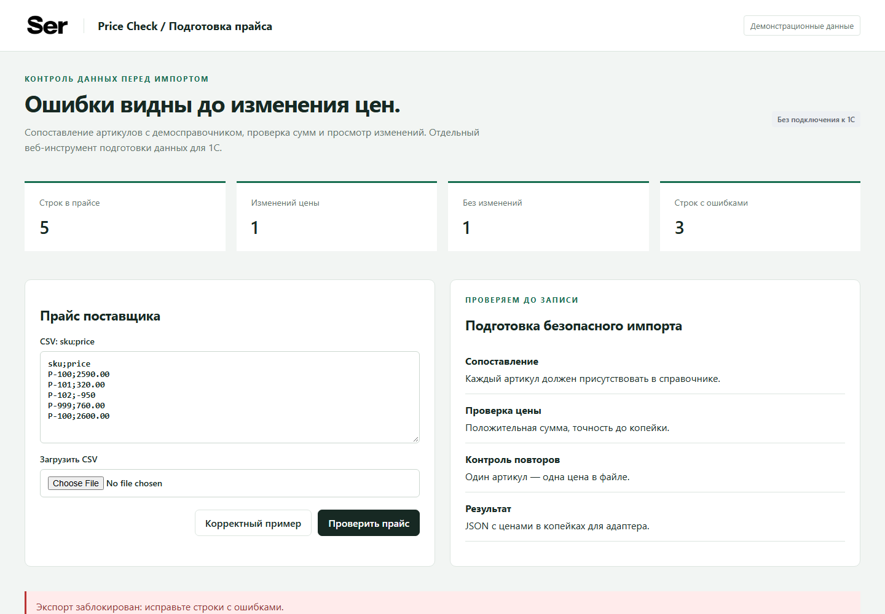
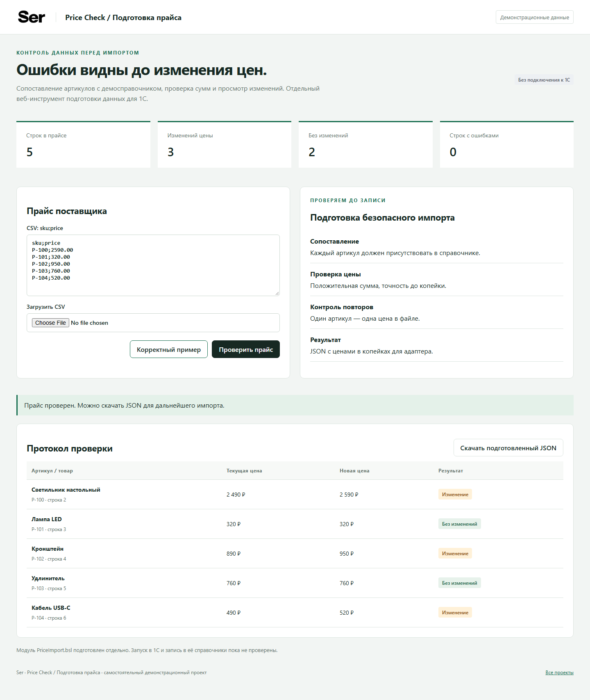

# Ser Price Check — проверка прайса перед импортом

Самостоятельный веб-инструмент подготовки прайса для дальнейшего импорта в учётную систему. Проверяет CSV по демосправочнику: неизвестные и повторные артикулы, положительные цены, точность до копейки. Показывает старую и новую цену. Экспорт JSON доступен только после исправления всех ошибок. Скриншоты сняты с реально работающего веб-инструмента. Это не интерфейс 1С и не подтверждение интеграции. Модуль PriceImport.bsl включён в исходники как непроверенная заготовка; запуск внутри 1С отложен до установки платформы. Данные вымышленные.

**Стек:** JavaScript · CSV · JSON

[Полный комплект исходников, инструкций и проверок](ser-polyglot-source.zip). Распакуйте и откройте `polyglot-lab/README.md`.

Проверка модуля в платформе 1С отложена владельцем до установки. Скриншоты показывают только веб-инструмент.
