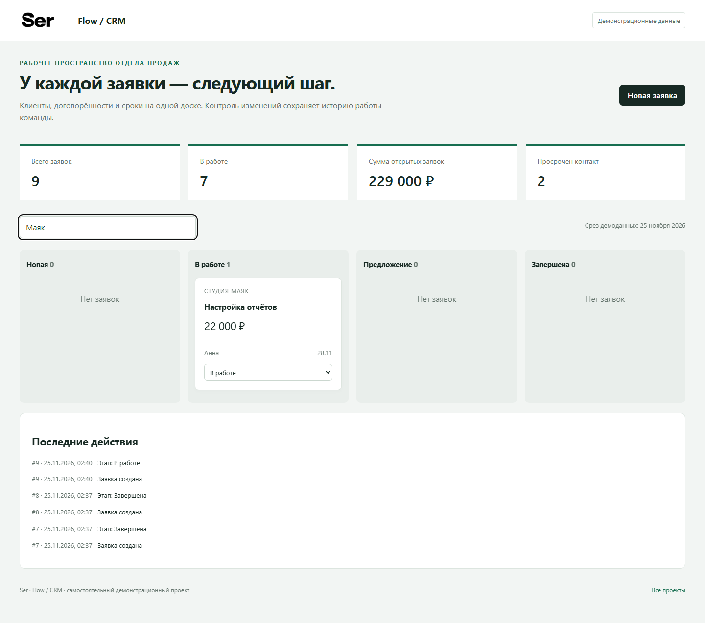
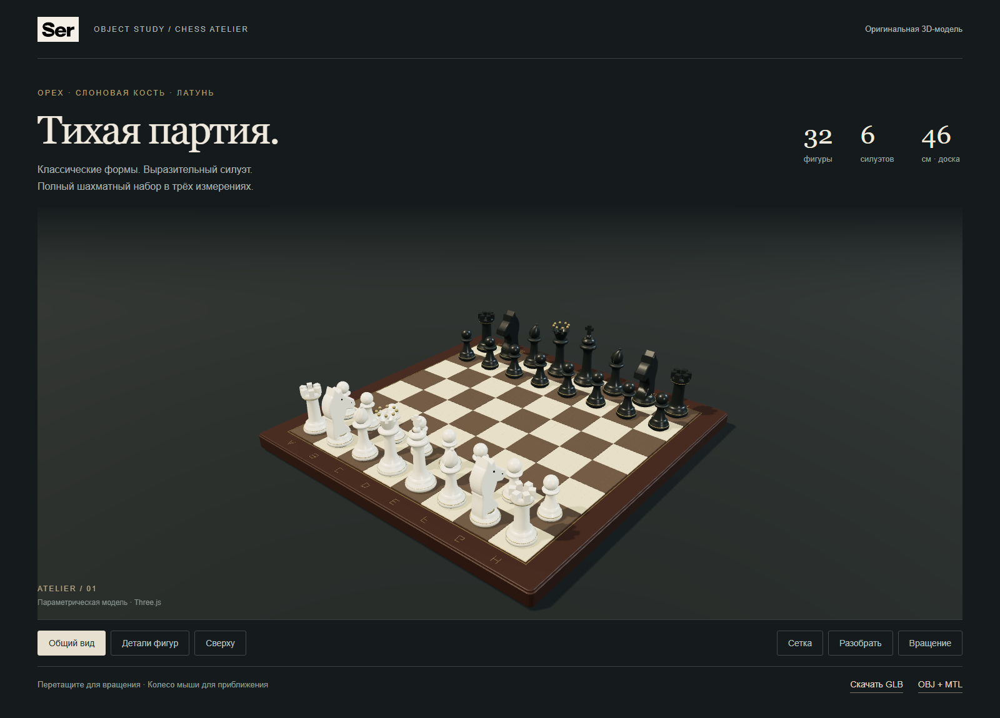

# Ser · приложения, автоматизации, игра и 3D

Восемь самостоятельных демонстрационных проектов Серафима Мельника. Все деловые данные вымышлены; изображения — настоящие скриншоты запущенных приложений и 3D-сцены.

| Проект | Технологии | Что делает |
|---|---|---|
| [Ser Flow — CRM на TypeScript](CRM.md) | TypeScript · Node.js · SQLite | Клиенты, этапы сделки и история действий. |
| [Ser Trade — кабинет оптовых заказов на PHP](WHOLESALE.md) | PHP · PDO · SQLite | Заказ из CSV с проверкой цен и остатков. |
| [Ser Approve — согласование расходов на C#](APPROVAL.md) | C# · ASP.NET Core · .NET 10 | Заявка, решение руководителя, отметка оплаты. |
| [Ser Price Check — проверка прайса перед импортом](PRICE-CHECK.md) | JavaScript · CSV · JSON | Артикулы, цены и дубли проверяются до импорта. |
| [Ser Radar — RSS и Atom парсер на Go](FEED.md) | Go · encoding/xml · HTTP · CSV | Подборки публикаций с фильтром и удалением дублей. |
| [Ser Balance — автоматическая сверка счетов и оплат](RECONCILE.md) | JavaScript · CSV · точные денежные расчёты | Частичные оплаты, переплаты и неизвестные платежи. |
| [Ser Cargo — браузерная головоломка](GAME.md) | JavaScript · Canvas · игровая логика | Шесть уровней, отмена хода и сохранение рекордов. |
| [Ser Chess — 3D-доска и полный набор фигур](CHESS.md) | Three.js · GLB · OBJ/MTL · 3D | 32 фигуры, 64 клетки и интерактивный просмотр. |

## Исходники и запуск

[Скачать полный проект ZIP](ser-polyglot-source.zip). В архиве сохранена исходная структура каталогов, package-lock, исходники всех восьми проектов, тесты, инструкции и скриншоты. Зависимости и локальные базы данных в архив не включены. Ключевые модули TypeScript, PHP, C#, Go и JavaScript дополнительно доступны для просмотра прямо в этой папке.

После распаковки откройте `polyglot-lab/README.md`: там команды запуска каждого сервиса и проверок. Для Node требуется версия 24+, PHP с PDO SQLite, .NET SDK 10 и Go 1.24+. Основной интерфейс работает локально на 127.0.0.1:8830. Серверные демо не развёрнуты как публичные многопользовательские сервисы.

## Проверка

Прошли 21 тест Node/TypeScript, 12 проверок PHP, 10 C# и 7 Go. Дополнительно проверены геометрия и повторный импорт GLB. В архиве сохранён браузерный протокол прохождения сценариев и проверки узкого экрана. Изображения не подменяют работу приложений.

## Ограничения

Это портфолио демонстрационных решений, а не история заказов клиентов. Демо содержат упрощённые сценарии; перед применением в компании необходимы адаптация к ТЗ, авторизация и проверка окружения. Модуль для платформы 1С подготовлен, но его запуск по решению владельца отложен до установки. Price Check проверен как отдельный веб-инструмент. Шахматы — цифровая концепция для визуализации, не готовая производственная модель.

