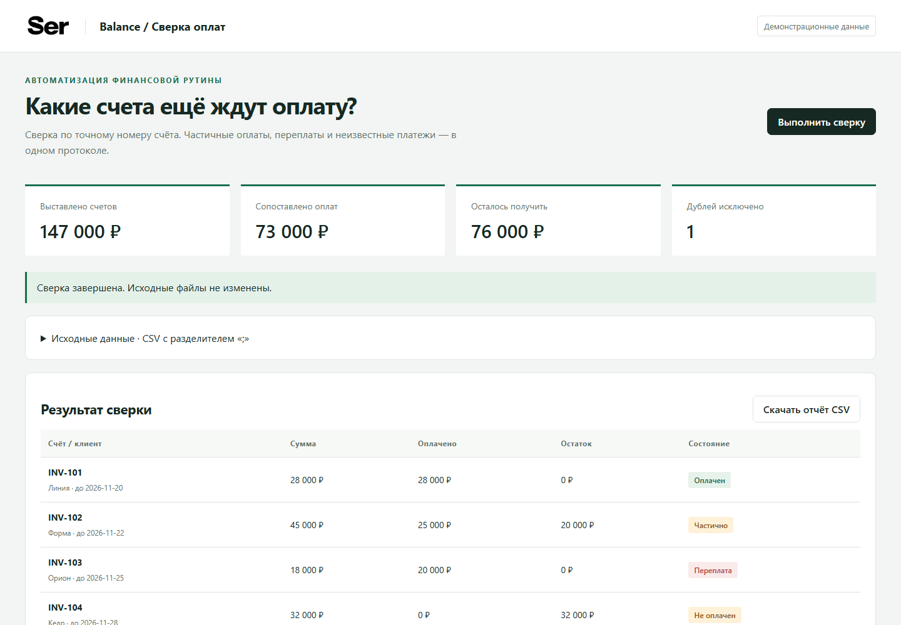
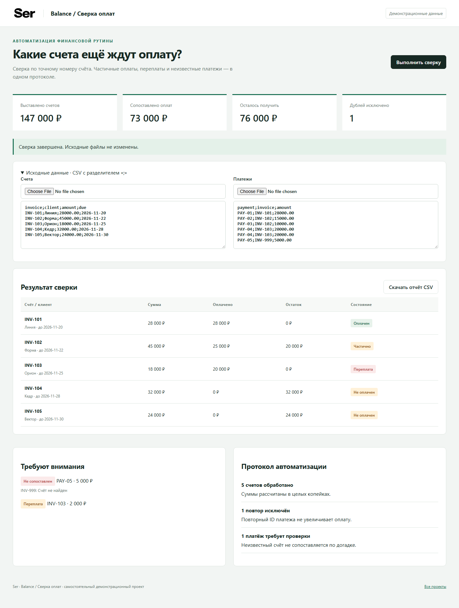

# Ser Balance — автоматическая сверка счетов и оплат

Самостоятельная автоматизация сверки двух CSV: выставленные счета и полученные оплаты. Сопоставляет по точному номеру счёта, объединяет частичные платежи, выделяет переплаты и неизвестные счета. Повторный ID не увеличивает оплату; конфликтующие данные одного платежа отклоняются. Расчёты выполняются в целых копейках. Есть загрузка файлов, протокол и экспорт отчёта. Демопример: 5 счетов на 147 000 ₽, сопоставлено 73 000 ₽, остаток 76 000 ₽, переплата 2 000 ₽ и один неизвестный платёж на 5 000 ₽. Скриншоты настоящие, данные вымышленные. Подключения к банку нет.

**Стек:** JavaScript · CSV · точные денежные расчёты

[Полный комплект исходников, инструкций и проверок](ser-polyglot-source.zip). Распакуйте и откройте `polyglot-lab/README.md`.
