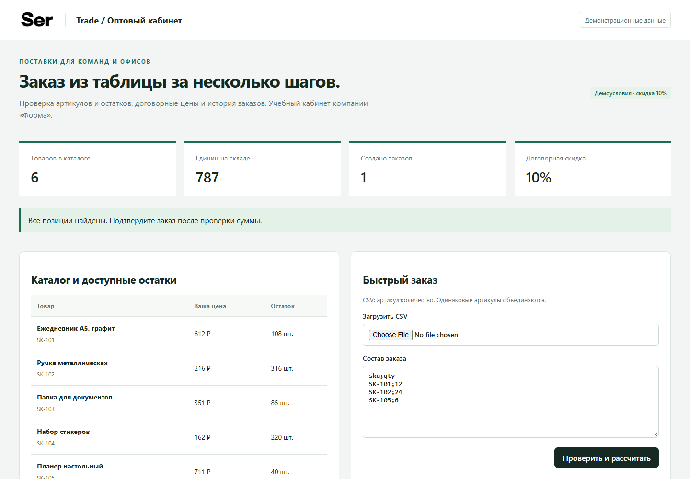
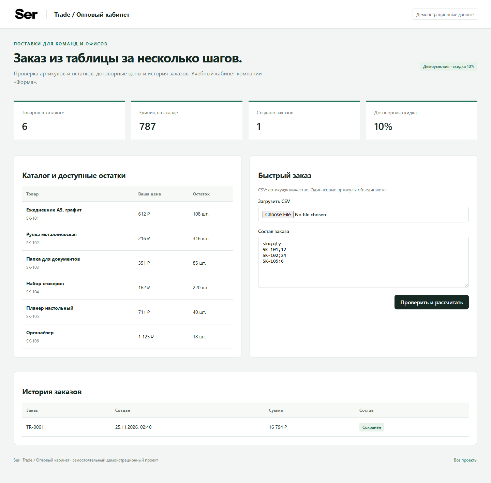

# Ser Trade — кабинет оптовых заказов на PHP

Самостоятельный демонстрационный кабинет на PHP и SQLite. Задача: принимать оптовые заказы из таблицы. Реализованы каталог, фиксированная демоскидка 10%, импорт CSV, объединение повторных артикулов, расчёт в копейках, проверка остатков, подтверждение и история заказов. Запись заказа и изменение остатков выполняются в одной транзакции. Повтор одного запроса не создаёт второй заказ. На скриншотах — проверка состава и сохранённый заказ. Вымышленные товары и компания; демо без оплаты и авторизации.

**Стек:** PHP · PDO · SQLite

[Полный комплект исходников, инструкций и проверок](ser-polyglot-source.zip). Распакуйте и откройте `polyglot-lab/README.md`.
