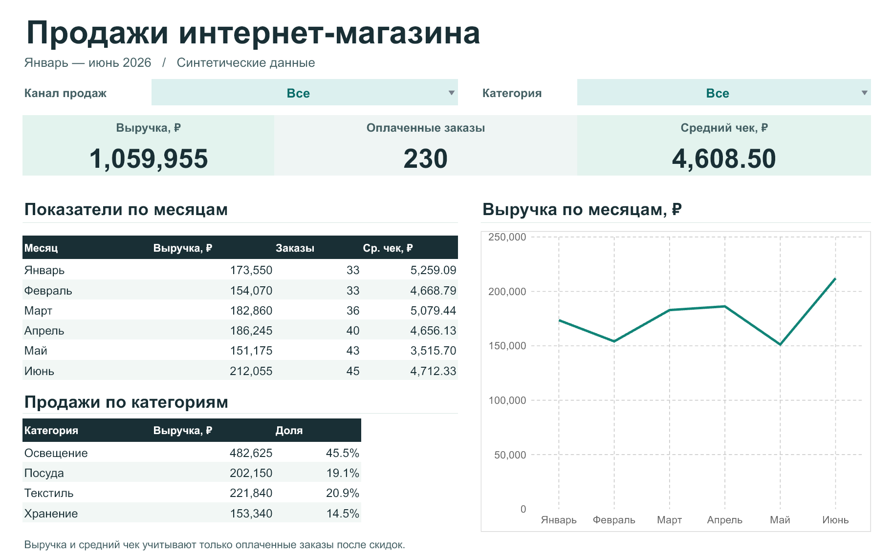

# Excel-отчёт по продажам интернет-магазина

Демонстрационный проект Серафима Мельника. Книга показывает, как менялись выручка и средний чек магазина товаров для дома с января по июнь 2026 года. Все 250 заказов синтетические.



## Работа с отчётом

Откройте `sales-report.xlsx` и выберите канал или категорию в зелёных ячейках листа «Обзор». Оба фильтра действуют одновременно. Карточки, таблицы и график пересчитаются. На листе «Заказы» можно проверить отдельные операции.

Одна строка соответствует одному заказу с товарами одной категории. Выручка оплаченного заказа равна количеству единиц, умноженному на цену за единицу после скидки. Сумма округляется до копейки. Отменённые заказы дают нулевую выручку и исключаются из среднего чека.

| Показатель за полугодие | Значение |
| --- | ---: |
| Оплаченные заказы | 230 |
| Выручка | 1 059 955 ₽ |
| Средний чек | 4 608,50 ₽ |

## Сборка из CSV

Для сборки нужен Python 3.8 или новее. Скрипт использует стандартную библиотеку и берёт оформление, фильтры и диаграмму из комплектной книги. Выполните команду из каталога проекта.

```sh
python generate_report.py orders.csv --output result.xlsx
```

На Windows также можно использовать `py -3` вместо `python`. Параметр `--template` задаёт путь к копии комплектной книги. Выходной файл должен иметь отдельное имя. Чтобы добавить заказы, допишите строки в копию CSV и передайте её путь первым аргументом программы.

Формат CSV — UTF-8 с BOM, разделитель «;». Сохраните имена столбцов из примера. Дата указывается в формате ДД.ММ.ГГГГ. Скидка задаётся в процентных пунктах, например 10 означает 10 %. Номер заказа должен быть уникальным. Генератор рассчитан на январь–июнь 2026 года и справочники из примера.

| Поле | Допустимые значения |
| --- | --- |
| Канал | Сайт, Маркетплейс, Соцсети |
| Категория | Освещение, Посуда, Текстиль, Хранение |
| Статус | Оплачен, Отменён |

Квадратная обложка находится в `cover.png`, подробный вид дашборда — в `dashboard.png`. Оба изображения показывают исходный пример.
